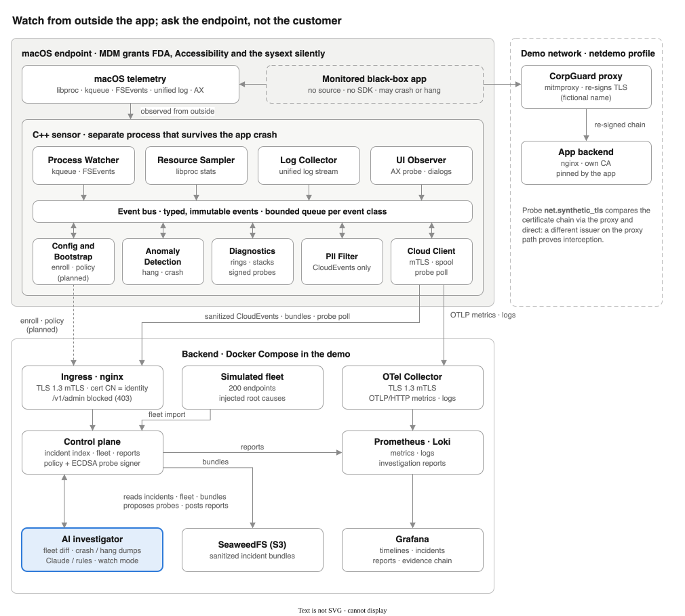
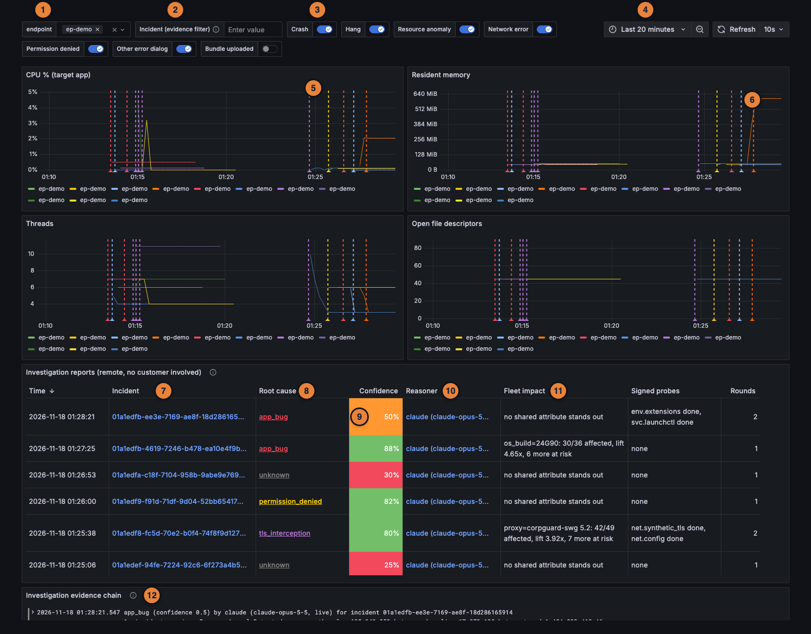
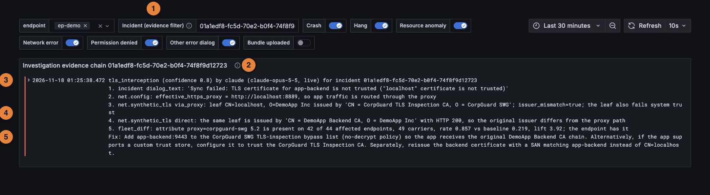
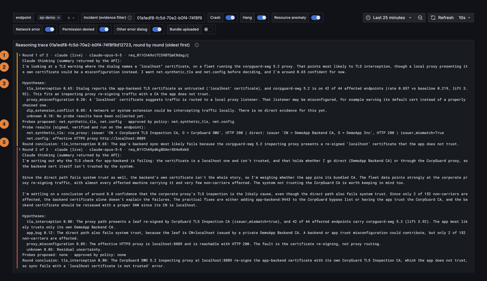

<a id="readme-top"></a>

<div align="center">

<h1>Ieso</h1>

<h3><i>Ask the endpoint, not the customer.</i></h3>

<p>
  macOS endpoint observability and remote diagnostics for business-critical applications.
</p>

<p>
  <a href="docs/DESIGN.md"><strong>Explore the design »</strong></a>
  <br><br>
  <a href="docs/AIREASONING.md">AI reasoning</a>
  ·
  <a href="docs/Ieso.svg">Architecture</a>
  ·
  <a href="#getting-started">Get started</a>
  ·
  <a href="https://github.com/artemtsai/ieso">GitHub repo</a>
</p>

<p>
  
  
  
  
  
  
  
</p>

</div>

<details>
  <summary><b>Table of contents</b></summary>
  <ol>
    <li><a href="#about-the-project">About the project</a>
      <ul>
        <li><a href="#how-it-works">How it works</a></li>
        <li><a href="#key-features">Key features</a></li>
        <li><a href="#built-with">Built with</a></li>
      </ul>
    </li>
    <li><a href="#getting-started">Getting started</a>
      <ul>
        <li><a href="#prerequisites">Prerequisites</a></li>
      </ul>
    </li>
    <li><a href="#run-the-full-demo">Run the full demo</a>
      <ul>
        <li><a href="#1-one-time-setup">1. One-time setup</a></li>
        <li><a href="#2-start-everything">2. Start everything</a></li>
        <li><a href="#3-break-the-app">3. Break the app</a></li>
        <li><a href="#4-use-grafana">4. Use Grafana</a></li>
        <li><a href="#5-stop-everything">5. Stop everything</a></li>
        <li><a href="#troubleshooting">Troubleshooting</a></li>
        <li><a href="#no-anthropic-api-key-needed">No ANTHROPIC API key needed</a></li>
      </ul>
    </li>
    <li><a href="#repository-layout">Repository layout</a></li>
    <li><a href="#documentation">Documentation</a></li>
    <li><a href="#roadmap">Roadmap</a></li>
  </ol>
</details>

## About the project

A business-critical app runs on managed Macs, and users report problems: it hangs, crashes, slows down or silently
stops working. Its logs help only somewhat, and in an enterprise the end user is often unreachable. So the classic
loop of asking the user, reproducing the problem and collecting logs breaks.

Leso replaces that loop. A Leso **sensor** on each Mac watches the app from outside its process. An **investigator** in
the cloud compares the incident with the whole fleet, then asks the endpoint for evidence through **signed,
read-only probes**. The result is a root-cause report with its evidence chain, and nobody had to call the customer.

Two constraints shape everything:
- **Black-box target.** We don’t own the app’s source: no SDK, no custom log lines, no symbols. Every signal comes
  from macOS telemetry.
- **Survive the failure.** A crash or deadlock would take an in-process reporter down with it, so the sensor is a
  separate process that outlives the app.

### How it works

| 1. Detect | 2. Remember | 3. Enrich | 4. Investigate | 5. Explain |
| --- | --- | --- | --- | --- |
| Lifecycle, resources, unified logs, crash and hang reports, an Accessibility responsiveness probe, error dialogs | A tiered flight recorder: 5 s at 100 ms, 10 min at 1 s, 24 h of 1-minute aggregates | On an anomaly: raise the app’s log level, take a stack sample, freeze the recorder | In the cloud: fleet diff, then signed probes chosen by an AI reasoner and approved by policy | A Grafana timeline and a report with root cause, confidence, evidence chain and fix |

<div align="center">
  
</div>

### Key features

- **Outside-in detection** of crashes, hangs, leaks, network failures and permission denials, for an app with no
  instrumentation.
- **A sidecar that survives the crash.** The sensor is a C++17 actor runtime. Its actors talk only through an event
  bus, incidents are never dropped, and its budget is under 1% CPU and 50 MB RSS.
- **Privacy by construction.** A PII filter is the only way out of the Mac, so user names, home paths, emails and
  secrets are redacted and IP addresses hashed before anything leaves.
- **TLS 1.3 + mutual TLS only**, on every hop from endpoint to backend. TLS 1.2 is refused on both sides, and events
  survive being offline in an at-least-once disk spool.
- **Fleet differential diagnosis.** Over 200 simulated endpoints plus the real Mac, it finds which attribute the
  failing endpoints share, for example a proxy version with 3.9× lift.
- **The LLM proposes, the policy decides.** Probes are allowlisted IDs, never commands. Each request is checked three
  times and signed with ECDSA, and the endpoint verifies it against a pinned key before running it. Reports show
  every round of the AI’s reasoning.

### Built with

| Area | Technology |
| --- | --- |
| Sensor | C++17, CMake + Ninja, GoogleTest, {fmt}, libcurl, macOS libproc / kqueue / FSEvents / Accessibility / Security.framework |
| Demo app | Swift + AppKit, with fault switches |
| Backend | nginx (mTLS ingress), OpenTelemetry Collector, Prometheus, Loki, Grafana, SeaweedFS (S3), FastAPI control plane, Docker Compose |
| Investigator | Python 3.12, the Anthropic SDK (Claude Opus 5.5), an offline rule reasoner, a simulated fleet |
| Demo network | mitmproxy as a fictional TLS-inspecting corporate proxy (“CorpGuard”) |

<p align="right">(<a href="#readme-top">back to top</a>)</p>

## Getting started

### Prerequisites

- **macOS 14 or later** with the Xcode command-line tools: `xcode-select --install`. They include `git`, the Swift
  compiler for the demo app, and the C++ compiler.
- **The code.** Clone the repo with git and change into it:
  ```sh
  git clone https://github.com/artemtsai/ieso.git
  cd ieso
  ```
  Run every command in this README from that folder, the repo root.
- **CMake ≥ 3.24 and Ninja, from [MacPorts](https://www.macports.org/install.php).** Install MacPorts with the
  installer for your macOS version, then:
  ```sh
  sudo port selfupdate && sudo port install cmake ninja
  ```
  MacPorts puts them in `/opt/local/bin`. The scripts find them there even when your shell or VS Code doesn’t have
  that folder on its `PATH`.
- **Docker Desktop**, for the backend: Grafana, the control plane, the investigator and the demo network all run in
  containers.
  1. Download it from [docker.com/products/docker-desktop](https://www.docker.com/products/docker-desktop/). Pick
     the build for your Mac’s chip: **Apple silicon** or **Intel** (Apple menu → About This Mac shows which).
  2. Open the downloaded `Docker.dmg` and drag **Docker** into **Applications**.
  3. Start it once from Applications, or with `open -a Docker`. Accept the terms, and enter your password when it
     asks to install its helper. Wait until the menu-bar whale icon says Docker Desktop is running.
  4. Check it from a terminal:
     ```sh
     docker info >/dev/null && docker compose version
     ```
  Give it at least 4 GB of memory (Docker Desktop → Settings → Resources). The demo runs ten containers. Docker
  Desktop is free for personal use, education and small businesses; larger companies need a paid subscription, so
  check its license terms before using it at work. `scripts/demo_up.sh` starts Docker Desktop itself if it’s
  installed but not running.
- **Python 3.12+**, for running the investigator and tests on the host (the containers bring their own): the
  [python.org](https://www.python.org/downloads/macos/) installer, or `sudo port install python312`.
- **The Accessibility permission** for the app that runs the sensor (Terminal or VS Code), under System Settings →
  Privacy & Security → Accessibility. The hang probe and dialog capture need it.
- **Optional:** an Anthropic API key for live Claude investigations. Everything works without one; see
  [No API Key](#no-anthropic-api-key-needed).

To build and test the parts on their own instead (developers), see [sensor/README.md](sensor/README.md) for the sensor and the component READMEs for the rest. For the demo, `scripts/demo_up.sh` builds everything it needs.

<p align="right">(<a href="#readme-top">back to top</a>)</p>

## Run the full demo

From a clean Mac to the whole system running (Grafana, the always-on AI investigator and the sensor), then breaking
the app in every way it can break and finding the cause in Grafana.

### 1. One-time setup
1. Install the [prerequisites](#prerequisites), including cloning the repo, and open a terminal in the repo root.
2. Grant **Accessibility** to the app you'll run the scripts from (Terminal, iTerm or VS Code): System Settings →
   Privacy & Security → Accessibility. Without it, hangs and error dialogs aren't detected.
3. Optional, for live Claude investigations: `cp backend/.env.example backend/.env`, then set `ANTHROPIC_API_KEY`.
   Without a key, the investigator uses its offline rule reasoner, which produces the same report shape.

### 2. Start everything
```sh
scripts/demo_up.sh
```
On the first run it builds the sensor and the demo app and generates the local certificates, which takes a few
minutes. It then does the following:
- starts Docker Desktop if needed;
- brings up the backend: Grafana, the control plane, the always-on `investigator-watch`, and the demo network with
  the CorpGuard proxy;
- imports the 200-endpoint simulated fleet and registers this Mac;
- starts the sensor in the background.

It ends by printing the Grafana link. The script is safe to run again.

### 3. Break the app
Each command launches DemoApp with one fault, waits until the incident reaches the backend, then waits for the
investigator's report and prints it with Grafana links:

| Command | What breaks | Marker in Grafana | Typical report |
| --- | --- | --- | --- |
| `scripts/demo_fault.sh crash` | DemoApp writes through a NULL pointer (EXC_BAD_ACCESS, SIGSEGV) | red | `app_bug` ~0.90, with the crash dump |
| `scripts/demo_fault.sh hang` | The main thread sleeps for 30 s, so the UI stops responding | light blue | `app_bug` ~0.90, from the main-thread stack |
| `scripts/demo_fault.sh leak` | Memory grows by 20 MB/s until the sensor flags it, then the script closes the app | dark orange | `app_bug`, moderate confidence (no heap capture yet) |
| `scripts/demo_fault.sh network` | The backend call goes through a TLS-inspecting proxy; the app pins its own CA and shows *Cannot reach server* | purple | `tls_interception` ~0.80–0.90, via the fleet diff and two signed probes |
| `scripts/demo_fault.sh permission` | The app reads a privacy-protected file and shows *Permission denied* | yellow | `permission_denied` ~0.80–0.86 |

Other ways to break it:
- **The DemoApp window:** `open build/demo-app/DemoApp.app` has a button for each fault. Its *Network failure*
  button alone calls an unreachable host; for the TLS-interception story, use `demo_fault.sh network`.
- **Launch arguments:** `open -n build/demo-app/DemoApp.app --args --fault <crash|hang|leak|permission> --after 4`.
- **Claude Code:** `/cause-crash`, `/cause-hang`, `/cause-leak`, `/cause-network` and `/cause-permission`.

Crashing many times in a day makes macOS stop writing crash reports. The sensor still catches the crash from its
exit signal and reports `DemoApp SIGSEGV (no crash report)`; with no stack to go on, the investigator answers
`unknown` instead of guessing.

### 4. Use Grafana
Open the link that `demo_up.sh` printed, or http://localhost:3000 → Dashboards → **Ieso - endpoint timeline**. No
login is needed.

<div align="center">
  
</div>

| # | What it is | How to use it |
| --- | --- | --- |
| 1 | **endpoint** picker | Choose `ep-demo`, this Mac. The simulated fleet has no live metrics. |
| 2 | **Incident (evidence filter)** | Filled in by a click in the table (7, 8). Clear it to see every report's evidence again. |
| 3 | **Marker toggles** | Show or hide one kind of incident marker. They double as the color legend: crash red, hang light blue, resource dark orange, network purple, permission yellow. |
| 4 | **Time range** and refresh | Use "Last 15 minutes" or "Last 30 minutes" while you break the app. The view refreshes every 10 s. |
| 5 | **Incident markers** | One dashed line per incident, across all four charts. Hover over a marker to see the crash signature, hang duration or dialog text. |
| 6 | **Metric charts** | DemoApp's CPU, memory, threads and open files. The leak shows as memory climbing. |
| 7 | **Incident** column | Click it to open that incident's **evidence chain**, full screen. Press **Esc** to come back. |
| 8 | **Root cause**, colored by cause | Same click as 7. |
| 9 | **Confidence** | Green at 80% or higher, orange from 50%, red below. |
| 10 | **Reasoner** | Click it to open the round-by-round **reasoning trace**. Press **Esc** to come back. |
| 11 | **Fleet impact** | The attribute the affected endpoints share, its lift, and how many more endpoints are at risk. |
| 12 | **Investigation evidence chain** | The newest reports' evidence, root cause and fix. Further down: the raw incidents and every sanitized event. |

The **evidence chain** (click 7 or 8) shows one report's reasoning as a list of concrete observations:

<div align="center">
  
</div>

1. The incident filter, now set to the clicked incident.
2. The panel, filtered to that incident.
3. The conclusion: root cause, confidence, reasoner.
4. The evidence: the dialog, the probe results (CorpGuard issuer via the proxy, DemoApp's own CA direct) and the
   fleet statistic.
5. The suggested fix.

The **reasoning trace** (click 10) shows how the investigator got there, one round at a time:

<div align="center">
  
</div>

1. The round header: engine, model and API request ID.
2. Claude's thinking summary, as returned by the API. The rule reasoner shows its rule set instead.
3. The hypotheses, with confidences and rationales.
4. The probes Claude proposed, what the policy approved, and the probe results (signed, verified and run on the Mac).
5. The round's conclusion. The next round starts below it.

Also useful:
- **Explore** (compass icon) → **Loki**, for raw queries such as `{service_instance_id="ep-demo"}`. Add
  `| event_type="com.ieso.ProcessCrashDetected"` to see only crashes.
- **A stale view:** if the dashboard looks out of date or shows odd rows, reload the page. An open tab keeps the
  dashboard it first loaded.

### 5. Stop everything
```sh
scripts/demo_down.sh            # keeps incidents, reports and Grafana history
scripts/demo_down.sh --wipe     # also deletes all demo data: a clean slate
```

### Troubleshooting
| Symptom | Fix |
| --- | --- |
| A hang or error dialog isn't detected | Grant Accessibility to the app running the scripts, then run `demo_down.sh` and `demo_up.sh` again. |
| `demo_up.sh` says a sensor is already running | `scripts/demo_down.sh` |
| A report says `unknown`, and its probes show `429 probe budget exhausted` | The control plane allows 20 probes per endpoint per hour. For rehearsals, start with `IESO_PROBES_PER_ENDPOINT_HOUR=60 scripts/demo_up.sh`. |
| A crash comes back as `no crash report` | macOS is throttling DemoApp's crash reports after many crashes; it eases over the day. |
| A report doesn't appear | The watcher caps itself at 20 investigations per hour; incidents over the cap wait. Check with `cd backend && docker compose --profile watch logs investigator-watch`. |

<p align="right">(<a href="#readme-top">back to top</a>)</p>


### No ANTHROPIC API key needed

The demo is complete without an Anthropic API key. No key is bundled in the repo.

| You have | Run | You get |
| --- | --- | --- |
| no key | `scripts/e2e_investigation.sh` | The offline **rule reasoner**: a complete investigator with the same report shape, also used by air-gapped tenants |
| no key, want to see Claude | the same command | A **replay** of the recorded Claude session in `investigator/recordings/`. Policy, signing, probes and the fleet diff still run live, and the report says it’s a replay. |
| your own key | `export ANTHROPIC_API_KEY=...` (or `backend/.env`), then the same command | **Live Claude** (`claude-opus-5-5`), checked against the rule reasoner. Add `IESO_RECORD=1` to save a new recording. |

Every run prints the active mode, for example `Claude reasoner: ENABLED (claude-opus-5-5)`.

## Repository layout

| Folder | What’s inside |
| --- | --- |
| [`sensor/`](sensor/README.md) | The C++17 agent: `core/` (bus, runtime, pools, flight recorder, spool, redactor), `ontology/` (every event type), `actors/` (one folder per actor), `platform/macos/`, `host/`, `tests/` |
| [`demo-app/`](demo-app/README.md) | The “business-critical” macOS app, with fault switches: hang, crash, leak, network, permission |
| [`backend/`](backend/README.md) | Docker Compose: mTLS ingress, OTel Collector, Prometheus, Loki, Grafana, SeaweedFS, control plane, the demo network |
| [`investigator/`](investigator/README.md) | Fleet diff, the Claude / rule / replay reasoners, the probe loop, watch mode |
| [`sim/`](sim/README.md) | The simulated fleet: 200 endpoints with injected root causes |
| `scripts/` | Test runner, smoke and e2e tests, `demo_fault.sh` |
| [`docs/`](docs/DESIGN.md) | Design, AI reasoning, style guide, diagrams |
| [`.claude/skills/`](.claude/skills/README.md) | The 12 Claude Code skills used to build and demo the project |

## Documentation

| Document | Covers |
| --- | --- |
| [Design](docs/DESIGN.md) | Problem exploration, requirements, events ontology, actor matrix, mechanisms, backend, security, scope |
| [AI reasoning](docs/AIREASONING.md) | Where the investigator runs, the loop, the reasoners, probe checks, guardrails, results |
| [Architecture diagram](docs/Ieso.svg) | The whole system ([draw.io source](docs/Ieso.drawio)) |
| [Investigation flow](docs/investigator-flow.svg) | The remote-investigation loop, slide-ready |
| [Style guide](docs/STYLEGUIDE.md) | The C++ rules every change follows |
| [Sensor internals](sensor/README.md) | Core headers, actors, tests, known gaps |
| [Backend](backend/README.md) · [Investigator](investigator/README.md) · [Simulated fleet](sim/README.md) | Per-component details |

<p align="right">(<a href="#readme-top">back to top</a>)</p>

## Roadmap

- [x] **Step 1:** sensor core: bus, actor runtime, pmr pools, tiered flight recorder, PII filter, spool
- [x] **Step 2:** macOS collectors, anomaly and diagnostics actors, the demo app
- [x] **Step 3:** cloud client (TLS 1.3 + mTLS), the backend stack, sanitized bundle upload
- [x] **Step 4:** simulated fleet, the investigator, ECDSA-signed probes, the TLS-interception scenario
- [x] **Step 5:** demo script and presentation
- [ ] Endpoint Security and Network Extension system extensions for deep telemetry (never kexts)
- [ ] A heap-capture probe, to give leaks high-confidence root causes
- [ ] Real enrollment and configuration actors (designed; stubbed with pre-generated certificates)
- [ ] The full probe allowlist: `perm.tcc`, `env.profiles`, `log.window`, `es.capture`
- [ ] Baseline diff, bundle signing, zstd spool compression
- [ ] Scale-out and multi-tenancy
