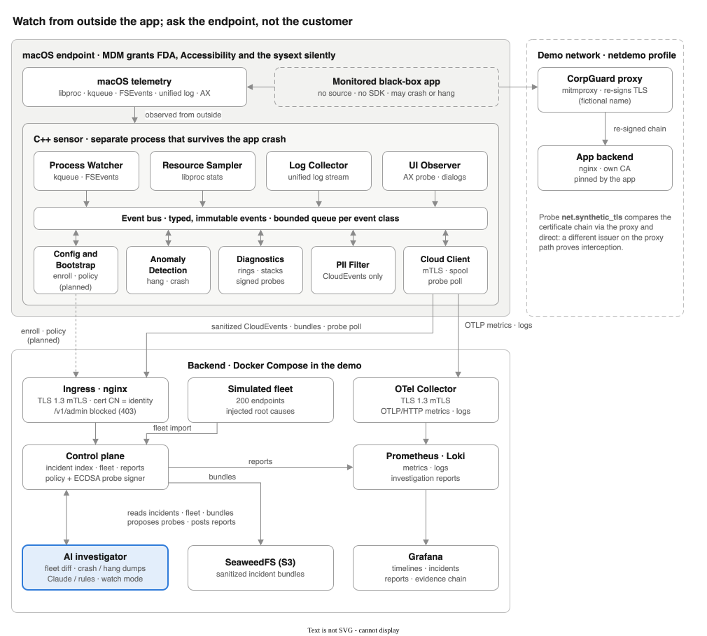

# System Design: Enterprise Endpoint Observability & Remote Diagnostics Agent (macOS)

Nov 17, 2026 · @Artem

## 1. Executive summary

We propose an out-of-process macOS sensor plus a cloud investigator that diagnoses a business-critical app we cannot recompile, on endpoints whose users we cannot reach. The guiding idea: **ask the endpoint, not the customer.**

**Problem.** A business-critical app on managed macOS endpoints hangs, crashes, slows down or silently fails. Its logs are only somewhat helpful. In an enterprise, the end user is often unreachable, so the classic loop ("please send logs, reproduce with debug on") does not work.

**Two hard constraints shape the design:**

- **Black-box target.** We do not own the source. No in-app SDK, no MetricKit, no custom log lines, no symbols. Everything is observed from outside through OS telemetry.
- **Survive the failure.** The sensor cannot live inside the target process. A SIGSEGV or deadlock there would kill the reporter with it. A separate sidecar survives the app's death, captures post-mortem state and still ships the bundle.

**What the system does:**

1. **Detect.** Watches the app from outside: lifecycle, resources, unified logs, crash and hang reports, an Accessibility-based responsiveness probe, user-visible error dialogs.
2. **Remember.** A tiered flight recorder keeps seconds of high-resolution history and hours of aggregates, so slow failures are covered as well as sudden ones.
3. **Enrich.** On an anomaly it temporarily raises the app's own log verbosity (`log config`), takes targeted deep captures and diffs the machine against its last healthy baseline.
4. **Investigate remotely.** The backend runs a hypothesis-driven loop. An AI investigator compares the incident with the rest of the fleet, then requests signed, allowlisted diagnostic probes from the endpoint, without involving the customer.
5. **Explain.** Grafana timelines, an incident index and a root-cause report with its evidence chain.

## 2. Problem exploration

"The app has problems" covers at least eight failure classes. Each one leaves different fingerprints that macOS records about any process, so the sensor is designed around this table rather than around crashes alone.

| Symptom class | Typical enterprise cause | Outside-in signals that detect it |
| --- | --- | --- |
| Crash / crash loop | Bad update, injected library, memory corruption | kqueue `NOTE_EXIT`, new `.ips` in DiagnosticReports (exception, termination reason, faulting module), `launchctl print` last exit code |
| Hang / beachball | Main-thread deadlock, blocking I/O, slow network call on UI thread | Accessibility responsiveness probe, `.hang`/`.spin` reports, `sample`/spindump, runningboardd logs |
| Slowness/degradation | Memory leak, disk full, thermal throttling, AV scanning its files | Tiered resource history (RSS, CPU, FDs, threads), `memory_pressure`, `pmset -g therm`, free disk |
| Network failure | Proxy/PAC, DNS split-horizon, TLS interception, VPN filter | Unified log (network, mDNSResponder, TLS trust), `scutil --proxy/--dns`, `nettop`, synthetic probe to app backend |
| Feature silently broken | TCC denial, sandbox deny, MDM restriction | Unified log (TCC, sandbox, syspolicyd), TCC.db state, `profiles show` |
| Won't launch | Broken signature, quarantine, App Translocation, Gatekeeper | `codesign`, `spctl`, `xattr` quarantine, syspolicyd log |
| Conflict with other agents | Another EDR, DLP or VPN network filter | `systemextensionsctl list`, `kmutil showloaded`, ES exec/open events, timing correlation |
| Breaks after sleep/wake or update | Stale sockets, helper not restarted, OS upgrade | `pmset -g log`, `launchctl` helper state, baseline diff (OS build, profiles, extensions) |

**Why the existing logs are only "somewhat helpful":** the app logs at its default level, much of the useful context is in *Apple's* subsystems rather than the app's, and private values are redacted. The design addresses all three: correlate Apple subsystems, escalate the app's own verbosity on demand, and keep privacy redaction as an explicit policy.

### Privilege tiers

| Tier | What it unlocks | Enterprise delivery |
| --- | --- | --- |
| User (no root) | NSWorkspace events, libproc stats, user crash reports, most `log show`, `launchctl gui/`, app prefs and logs, AX probe | LaunchAgent |
| Root | `log collect`/`log config`, spindump, `fs_usage`, `profiles`, system crash reports | LaunchDaemon via MDM |
| Full Disk Access + entitlements | Endpoint Security (`eslogger` or ES client), TCC.db | MDM PPPC profile grants FDA and Accessibility silently; system extension pre-approved by MDM |

The enterprise reality matters: the end user never clicks "Allow". MDM pre-approves every permission, so the sensor keeps working on endpoints we cannot touch.

## 3. Core design principles

The sensor is a small, native, actor-based C++17 process whose throughput and memory are bounded by construction. The backend is where the expensive reasoning happens.

**Why C++ for the sensor.** It is native code with no managed runtime, which gives predictable packaging and a footprint of under 1% CPU and 50 MB RSS. It also maps directly onto the native APIs we need: libproc, kqueue, FSEvents, Accessibility, Security.framework and Endpoint Security.

**Endpoint Security system-extension readiness, not kernel.** On modern macOS, kernel extensions are deprecated. Deep telemetry comes from Endpoint Security and Network Extension frameworks, which run as *user-space system extensions*. The event source interface (`IEventSource`) is designed so that a future ES client extension plugs in over XPC without touching the bus or the actors.

**Actors on an event bus.**

- Each actor owns one responsibility, consumes events by type and posts new events. Actors never reference each other.
- Events are immutable once posted (`shared_ptr<const Event>`).
- Posting is asynchronous only; no actor blocks another.
- Subscriptions are typed: `bus.subscribe<ProcessCrashDetected>(handler)` returns an RAII token that unsubscribes on destruction.

**Bounded everything.**

- Each event class has a **bounded queue and an explicit overflow policy**:
  - routine telemetry: sample or drop oldest, and count the drops
  - incidents and control messages: never dropped; spill to the spooler instead
- Back-pressure is visible: queue depth and drop counters are themselves telemetry.

**Memory pooling where it pays.** Hot paths (events, ring-buffer slots) use pre-sized `std::pmr` pool resources created in `main()` before the runtime starts. Capacities are `constexpr` constants in one config header and are overridable by policy within hard caps. This avoids heap fragmentation in a long-running agent. It is a measured choice, not a blanket ban on allocation.

**Observer-effect budget.** Any capture that pauses or loads the target app (`sample`, spindump, `log collect`) is rate-limited per hour and per incident. The sensor must never become the cause of the business-critical app's problem.

**Privacy by default.** Allowlisted fields only, redaction at the edge, and no private log data unless policy explicitly enables it.

## 4. High-level architecture

Three tiers: an out-of-process sensor on each Mac, a control plane that issues policy and signed probes, and a backend where the AI investigator reasons over the whole fleet.

*Source: [`Ieso.drawio`](Ieso.drawio). After editing it, re-export with `/Applications/draw.io.app/Contents/MacOS/draw.io --export --format svg --border 16 --output docs/Ieso.svg docs/Ieso.drawio`.*

Read it top down. The sensor observes the app only through macOS telemetry. All actors talk only through the event bus, and only sanitized CloudEvents leave the Mac. Back in the cloud, the investigator turns bundles and fleet data into probe requests that return through the control plane: the loop that replaces asking the customer.

## 5. Functional requirements

FR-1 to FR-10 keep the original intent, with mechanisms made concrete. FR-11 to FR-17 are new and answer the "logs are only somewhat helpful" and "customer not accessible" parts of the prompt.

**Edge sensor**

- **FR-1 Black-box telemetry.** Collect process metrics (libproc), lifecycle (NSWorkspace, kqueue), unified log streams for the app and selected Apple subsystems, crash/hang reports, and install integrity, without modifying the target app.
- **FR-2 Tiered flight recorder.** Keep three rings (in memory, with the 10 min and 24 h tiers checkpointed to disk, NFR-11): 5 s at 100 ms, 10 min at 1 s, and 24 h of 1-minute aggregates. Freeze all three on an anomaly. This covers sudden freezes as well as slow leaks and disk exhaustion. A sensor restart, agent update or reboot must not erase the history.
- **FR-3 Anomaly and crash watchdog.** Detect hangs with an Accessibility responsiveness probe, and confirm with hang reports. Detect exits with kqueue `NOTE_EXIT`, then get the exit cause from the new `.ips` report via FSEvents, or from ES `NOTIFY_EXIT` when available. Also detect crash loops, resource anomalies, and helper-daemon failures (`launchctl print`).
- **FR-4 Incident bundle.** Package the frozen rings, the deep capture, the system snapshot and the baseline diff into a signed, versioned JSON bundle.
- **FR-5 Edge PII sanitization.** Only events marked egress-eligible pass through the PII filter, which wraps them in `CloudEventSanitized` envelopes (CloudEvents 1.0, unique `id`).

**Control plane and transport**

- **FR-6 Enrollment.** First run uses an MDM-delivered enrollment token. The device key pair is generated in the Keychain (Secure Enclave where available) and is never exported. The issued certificate binds the endpoint ID in its CN/SAN.
- **FR-7 Dynamic policy.** Apply new polling intervals, thresholds, probe allowlist and log levels at runtime without restarting the agent or the app.
- **FR-8 Store-and-forward.** On send failure, spool compressed events to disk. On reconnect, drain with priority (incidents first), rate limiting and backoff. Delivery is at-least-once, with dedupe by event ID at the backend.

**Backend**

- **FR-9 OTLP ingress.** An OpenTelemetry Collector receives metrics and logs. Incident bundles go to object storage.
- **FR-10 Dashboards.** Grafana shows process health time-series beside pre-crash logs and incident markers on one timeline.

**New: closing the diagnosis loop**

- **FR-11 Adaptive log verbosity.** When an anomaly fires, raise the target app's own os\_log subsystem to debug for N minutes (`log config --subsystem <vendor> --mode level:debug,persist:debug`), then revert automatically.
- **FR-12 User-visible error capture.** An AXObserver on the app's process records when an alert or sheet appears and captures its text, after redaction. This tells us what the user saw without asking them.
- **FR-13 Baseline and drift diff.** Keep a last-known-good snapshot of the environment (OS build, app version, profiles, system extensions, TCC grants, proxy/DNS). Each incident includes what changed since then.
- **FR-14 Remote diagnostic probes.** The backend can request probes from a signed, versioned allowlist (for example: synthetic TLS check through the user's proxy, `launchctl print` on the helper, TCC state, a 60 s ES capture). The endpoint enforces the allowlist and a budget.
- **FR-15 Fleet differential diagnosis.** Compare failing endpoints with healthy ones on the same app version and find the attributes that are over-represented among failures.
- **FR-16 AI investigator.** An LLM-driven loop reads the bundle and the fleet diff, forms ranked hypotheses, chooses probes to separate them, and stops at a root-cause report with its evidence chain and a confidence level.
- **FR-17 Incident index.** Every incident is searchable by endpoint, app version, symptom class, crash signature and root cause.

## 6. Non-functional requirements

Targets are written so they can be measured on a test Mac; each one names how it is enforced.

| ID | Requirement | Target | Enforced by |
| --- | --- | --- | --- |
| NFR-1 | CPU overhead | < 1% steady, < 5% during an incident capture | Polling intervals by policy; QoS `utility`/`background` threads; capture budget |
| NFR-2 | Memory and disk | < 50 MB RSS including rings; spool ≤ 250 MB, FIFO rotation | `std::pmr` pools with hard caps; spool size check before each write |
| NFR-3 | Power and thermal | No measurable battery impact on laptops | Background QoS, coalesced timers, reduced sampling on battery and under thermal pressure |
| NFR-4 | Observer effect | ≤ 1 `sample`/spindump per incident, ≤ 4 per hour | Capture budget in the Anomaly actor; policy-controlled |
| NFR-5 | Offline resilience | Survives multi-day offline; stale events past TTL purged | Compressed (zstd) spool, priority drain, TTL per event class |
| NFR-6 | Zero-trust transport | TLS 1.3 only with mTLS on every call (TLS 1.2 and older refused by both sides), pinned backend CA, short-lived certificates | Server `min_version` 1.3; sensor restricted to TLS 1.3 and rejects any other negotiated version; Keychain/Secure Enclave key, automatic rotation |
| NFR-7 | Edge PII filtering | No unsanitized event reaches Cloud Client or Spooler | Type-level egress marking; only the PII filter can construct `CloudEventSanitized` |
| NFR-8 | Tamper resistance | Bundles are signed; agent is hard to kill or alter | Signing with device key; launchd KeepAlive; ES self-protection in the future sysext |
| NFR-9 | Self-observability | The agent reports its own health | Heartbeat, queue depths, drop counters, capture budget usage |
| NFR-10 | Probe safety | No probe can change state or run arbitrary code | Signed allowlist, read-only probes, per-probe timeout and budget |
| NFR-11 | Flight-recorder durability | The 10 min (1 s) and 24 h (1 min) tiers survive sensor restart, agent update, crash and reboot; at most 60 s of history lost; the 5 s hot tier may be dropped | Crash-safe checkpoint (temp file + rename, versioned, CRC) every 60 s, on clean shutdown and before update; restored on start, samples older than their tier window discarded, restart gap marked in the rings; bounded at about 1 MB and counted in the NFR-2 disk budget; local file, 0600, metrics only (no PII) |

## 7. Events ontology

Every event carries `id` (UUIDv7), `endpoint_id`, `ts`, `class` and `egress` flag. The class sets the queue and its overflow policy; the egress flag decides whether the PII filter sees it.

| Event | Category | Class / overflow | Egress | Payload |
| --- | --- | --- | --- | --- |
| `DeviceBootstrapped` | Bootstrap | Control / never drop | No | Hardware fingerprint, endpoint ID |
| `CertificateAssigned` | Bootstrap | Control / never drop | No | Certificate reference (Keychain), expiry |
| `ConfigRefreshTriggered` | Configuration | Control / never drop | No | Source: timer or push |
| `ConfigurationUpdated` | Configuration | Control / never drop | No | Policy version, changed keys |
| `TargetLifecycle` | Telemetry | Control / never drop | Yes | Launch, exit, PID, version |
| `TelemetrySnapshotCaptured` | Telemetry | Routine / drop oldest | Yes (aggregated) | CPU, RSS, threads, FDs, disk, thermal |
| `LogRecordObserved` | Telemetry | Routine / sample | Yes | Subsystem, category, level, message |
| `UserVisibleErrorObserved` | Anomaly | Incident / never drop | Yes | Dialog text (redacted), window title |
| `ProcessHangDetected` | Anomaly | Incident / never drop | Yes | AX probe latency, duration, sample ref |
| `ProcessCrashDetected` | Anomaly | Incident / never drop | Yes | Exception, termination reason, module+offset signature |
| `ResourceAnomalyDetected` | Anomaly | Incident / never drop | Yes | Metric, value, baseline, trend |
| `DiagnosticEscalationRequested` | Diagnostics | Control / never drop | No | Reason, verbosity level, duration |
| `IncidentBundleReady` | Diagnostics | Incident / never drop | Yes | Bundle hash, frozen rings, deep capture, baseline diff |
| `ProbeRequested` | Investigation | Control / never drop | No | Probe ID, signed request, budget |
| `ProbeResultReady` | Investigation | Incident / never drop | Yes | Probe ID, output, exit status |
| `CloudEventSanitized` | Egress | By source class | — | CloudEvents 1.0 envelope (only the PII filter creates these) |
| `SpooledEvent` | Storage | Never drop | — | Sanitized envelope + attempt count |
| `SpoolStorageUpdated` | Storage | Routine | No | Spool size, oldest age |
| `NetworkStatusChanged` | Transport | Control | No | Online/offline |
| `TelemetryDelivered` | Transport | Routine | No | Event IDs acknowledged |

The main changes from the first draft: the new event types for user-visible errors, resource anomalies, escalation, incident bundles and probes, and the explicit egress and overflow columns.

## 8. Actor responsibility matrix

Eleven actors, each with one job. Collectors only observe, the Anomaly actor only judges, the Diagnostics actor only captures, and only the PII filter can produce egress events.

| Actor | Single responsibility | Subscribes to | Emits |
| --- | --- | --- | --- |
| Bootstrap | Enrollment, device key in Keychain, endpoint-bound certificate | Startup | `DeviceBootstrapped`, `CertificateAssigned` |
| Configuration | Fetch or receive policy; apply without restart | `ConfigRefreshTriggered`, control-plane push | `ConfigurationUpdated` |
| Process Watcher | Find the target app, track launch/exit (NSWorkspace, kqueue), watch DiagnosticReports (FSEvents) | `ConfigurationUpdated` | `TargetLifecycle`, `ProcessCrashDetected` |
| Resource Sampler | Poll libproc and system state on a timer; feed the flight recorder | `ConfigurationUpdated`, `TargetLifecycle` | `TelemetrySnapshotCaptured` |
| Log Collector | Run a filtered `log stream` for the app and selected Apple subsystems | `ConfigurationUpdated` | `LogRecordObserved` |
| UI Observer | AX responsiveness probe; AXObserver for error dialogs | `TargetLifecycle` | probe latencies, `UserVisibleErrorObserved` |
| Anomaly Detection | Judge hangs, crash loops and resource anomalies against thresholds and baseline | snapshots, lifecycle, logs, UI events | `ProcessHangDetected`, `ResourceAnomalyDetected`, `DiagnosticEscalationRequested` |
| Diagnostics | Freeze rings, raise log verbosity, take budgeted deep captures, compute baseline diff, run allowlisted probes | anomaly events, `ProbeRequested` | `IncidentBundleReady`, `ProbeResultReady` |
| PII Filter | Redact egress-eligible events and wrap them in CloudEvents | egress-eligible types only | `CloudEventSanitized` |
| Cloud Client | TLS 1.3 + mTLS egress; ack tracking | `CloudEventSanitized` | `SpooledEvent`, `TelemetryDelivered`, `NetworkStatusChanged` |
| Spooler | Compressed disk spool; priority, rate-limited drain on reconnect; TTL purge | `SpooledEvent`, `NetworkStatusChanged`, `TelemetryDelivered` | `SpoolStorageUpdated`, `CloudEventSanitized` (replay) |

The flight-recorder rings live inside the Diagnostics actor and are filled from snapshot and log events. No actor calls another.

## 9. Key mechanisms

These are the parts an OS-internals reviewer will probe; each names the exact macOS mechanism and its limits.

### 9.1 Hang detection without the source

We cannot read another process's main thread: `task_for_pid` is blocked for hardened-runtime apps without root and entitlements.

1. **Responsiveness probe.** Every 2 s, on a dedicated thread, call `AXUIElementCopyAttributeValue` on the app's AX element with `AXUIElementSetMessagingTimeout` set to 1 s. Accessibility requests are served by the app's main run loop, so a timeout means the main thread is not servicing events, which is essentially what the OS's "not responding" state reflects.
2. **Threshold.** N consecutive timeouts (policy, default 3) raise `ProcessHangDetected`.
3. **Confirmation and evidence.** Look for a new `.hang`/`.spin` report, and with root take one budgeted `sample <pid> 3` to get main-thread stacks.

Requires the Accessibility permission, granted silently through the MDM PPPC profile.

### 9.2 Crash detection

- `kqueue` with `EVFILT_PROC` / `NOTE_EXIT` reports that a non-child process exited, but not why.
- The *why* comes from the crash report: FSEvents on `~/Library/Logs/DiagnosticReports` and `/Library/Logs/DiagnosticReports` picks up the new `.ips` file (JSON since macOS 12). We parse the exception type, signal, termination reason and faulting thread.
- Without symbols, the crash signature is **faulting module + offset + exception type**. That is stable enough to group crashes across the fleet.
- With an ES client, `ES_EVENT_TYPE_NOTIFY_EXIT` gives the exit status directly.
- A clean exit with no report, preceded by memory pressure in runningboardd logs, is classified as "killed by the OS", not a crash.

### 9.3 Tiered flight recorder

| Ring | Resolution | Window | Catches |
| --- | --- | --- | --- |
| Hot | 100 ms | 5 s | Freezes, spikes just before a crash |
| Warm | 1 s | 10 min | Network stalls, gradual hangs |
| Cold | 1-minute aggregates (min/max/avg) | 24 h | Leaks, disk filling, after-sleep failures |

Rings are fixed-size arrays from the pool; writes are lock-free single-producer. A freeze copies them into the incident bundle and keeps recording.

**Durability (NFR-11).** The slow failures the warm and cold tiers exist for (leaks, disk filling, "breaks after an update") often span a sensor restart. So these two tiers are mandatorily persisted:
- A crash-safe checkpoint (temp file + atomic rename, versioned header, CRC) is written every 60 s, on clean shutdown and before an agent update.
- On start the checkpoint is restored and samples older than their tier window are discarded. A gap marker records the interval between the last checkpoint and the restart, so the timeline never interpolates across it.
- A corrupt or incompatible checkpoint is discarded with a warning and never blocks startup.
- Samples carry the target pid, so the restored history stays per process.
- The hot tier (5 s) is not persisted: after a restart it is stale by definition.

### 9.4 Adaptive log verbosity

1. An anomaly emits `DiagnosticEscalationRequested`.
2. The Diagnostics actor runs `log config --subsystem <vendor> --mode level:debug,persist:debug` (root), records the previous mode, and arms a revert timer (default 15 min).
3. The next occurrence is captured with debug logs, without contacting the customer.

This works only if the vendor uses os\_log subsystems, which most modern macOS apps do; otherwise we fall back to Apple subsystems plus deep capture.

### 9.5 Deep capture and baseline diff

An incident triggers a budgeted capture:

- `log collect --last 10m` filtered to relevant subsystems
- `sample` (if not already taken)
- `lsof -p` and `nettop -P -p`
- `launchctl print` of the app's helpers
- an environment snapshot

The snapshot is diffed against the last-known-good baseline (OS build, app version, profiles, system extensions, TCC grants, proxy/DNS, free disk).

### 9.6 PII routing

Egress eligibility is part of the event type. The PII filter subscribes only to those types, so it never sees its own output. `CloudEventSanitized` can only be built by the PII filter (private constructor, filter is a friend), so unsanitized data cannot reach egress by accident. Redaction covers user names in paths, emails, tokens, IPs (hashed), and free text from dialogs and logs.

### 9.7 Spool and replay without loops or storms

- Every envelope has a stable `id`; the backend dedupes, so delivery is at-least-once and safe to retry.
- On send failure the Cloud Client emits `SpooledEvent` with an attempt count; the Spooler writes it compressed.
- On reconnect the Spooler drains incidents first, then telemetry, rate-limited, with exponential backoff and jitter.
- If a replayed event fails again it is re-spooled in place, not duplicated.
- Events past their class TTL are purged, so a laptop offline for a week does not flood the backend.

## 10. Remote investigation and the AI investigator

When the customer cannot answer questions, the endpoint does. The investigator turns every "can you check...?" we would have asked the customer into a safe, signed probe.

### 10.1 Fleet differential diagnosis

One crash is a mystery; forty crashes that share an attribute are an answer.

- **Cohorts.** Group endpoints by app version and symptom (crash signature, hang, network error). Compare each failing cohort with healthy endpoints on the same app version.
- **Attributes compared:** OS build, hardware model, architecture/Rosetta, MDM profiles, installed system extensions and kexts, other security agents, proxy/VPN type, locale, recent baseline changes.
- **Scoring.** For each attribute value, compute lift (rate among failing ÷ rate among healthy) with a minimum support count. Return the top-ranked attributes as candidate explanations.
- **Example output:** "91% of endpoints with crash signature `libfoo+0x1a2c EXC_BAD_ACCESS` have DLP extension v4.2; 3% of healthy ones do."

### 10.2 Hypothesis-driven loop

1. **Triage.** The investigator receives the incident bundle, the baseline diff and the fleet-diff result.
2. **Hypothesize.** The LLM produces up to five ranked hypotheses. Each one states the evidence for it and **which probe would confirm or rule it out**.
3. **Plan.** A deterministic policy layer checks each requested probe against the allowlist, the endpoint's budget and the incident's scope. The LLM proposes; it never executes.
4. **Probe.** The signed request goes to the endpoint; the Diagnostics actor verifies the signature, runs it with a timeout, and the result comes back sanitized.
5. **Update.** Evidence is added, hypotheses are re-ranked. Stop when one hypothesis passes the confidence threshold, the budget is spent, or three rounds have run.
6. **Report.** Root cause, confidence, evidence chain (each claim linked to a log line, metric or probe output), fleet impact, and a suggested fix or workaround.

**Model use.** Claude through the API, with structured JSON output validated against a schema. An offline rule-based investigator, with the same interface, is the fallback for air-gapped customers and for the demo. Only sanitized evidence ever reaches the model.

### 10.3 Probe allowlist (initial)

All probes are read-only, time-boxed and versioned in policy.

| Probe | What it answers | Privilege | Cost |
| --- | --- | --- | --- |
| `net.synthetic_tls` | Can this machine reach the app backend through its real proxy, DNS and TLS path? Which certificate chain does it see? | User | Low |
| `net.config` | Proxy/PAC, DNS resolvers, VPN and content-filter extensions | User | Low |
| `svc.launchctl` | Is the app's helper loaded, running, and what was its last exit code? | User/root | Low |
| `perm.tcc` | Which privacy permissions does the app have, and were any revoked? | FDA | Low |
| `env.profiles` | Which MDM configuration profiles and restrictions apply? | Root | Low |
| `env.extensions` | Which system extensions and kexts are active? | User | Low |
| `proc.sample` | Main-thread and worker stacks right now | Root | Medium (pauses the app briefly) |
| `log.window` | Unified log for chosen subsystems in a time window | Root | Medium |
| `es.capture` | 60 s of ES exec/open/rename events for the app's process tree | Root + FDA | Medium |
| `fs.usage` | Disk usage of the app's container and caches | User | Low |

## 11. Backend

The backend separates three data shapes: time series, logs, and incident bundles. Each goes to the store built for it, and one incident index ties them together.

| Component | Role | Demo choice | At scale |
| --- | --- | --- | --- |
| Ingress | TLS 1.3-only mTLS termination, certificate-to-endpoint check, dedupe by event ID | OpenTelemetry Collector (Docker) | Collector fleet behind an L4 load balancer; Kafka between ingress and stores |
| Metrics | Process health time series | Prometheus | Mimir / Thanos |
| Logs | Sanitized log records and timelines | Loki | Loki cluster / ClickHouse |
| Bundles | Signed incident bundles (blobs) | SeaweedFS (S3 API) | S3 with lifecycle rules |
| Incident index | Searchable incidents, crash signatures, fleet attributes, root causes | SQLite / Postgres | Postgres + ClickHouse for cohort queries |
| Control plane | Enrollment, policy, probe requests (signed) | FastAPI service | Same, horizontally scaled; HSM-backed signing key |
| Investigator | Fleet diff + AI loop | Python worker | Queue-driven workers, per-tenant rate limits |
| UI | Health timelines, incident view, root-cause reports | Grafana + a small incident page | Same |

**Grafana views:** per-endpoint timeline (CPU/RSS/threads with crash, hang and dialog markers, logs below); fleet view (incidents by crash signature and app version); investigation view (hypotheses, probes run, evidence).

**Multi-tenancy:** every record carries a tenant ID derived from the client certificate, never from the payload.

## 12. Security, threat model and privacy

A diagnostics agent with root, Full Disk Access and a remote probe channel is an attractive target. The remote channel is therefore read-only by design, and everything that crosses it is signed.

| Threat | Mitigation |
| --- | --- |
| Compromised backend sends malicious probes | Probes are IDs from a signed allowlist, not commands. The endpoint verifies the policy signature (offline root key) and rejects anything not listed. No probe writes state or runs arbitrary code. |
| Probe abuse for data exfiltration | Per-probe output schemas, edge PII redaction, budgets per hour and per incident, every probe logged locally and centrally |
| Stolen device identity | Non-exportable key in Keychain / Secure Enclave, short-lived certificates, revocation at the control plane |
| Impersonated backend / TLS interception | Pinned backend CA; TLS 1.3 only (no downgrade to TLS 1.2 cipher suites); corporate TLS inspection must be bypassed for the agent's domain (documented deployment requirement) |
| Agent tampering or killing | Root-owned LaunchDaemon with KeepAlive, code signature checked at launch, heartbeat gaps alerted in the backend; ES-based self-protection once shipped as a system extension |
| Forged or altered incident bundles | Bundles hashed and signed with the device key; backend verifies before indexing |
| PII leak to the LLM | Only sanitized evidence is sent; tenant-level switch to use the offline investigator instead; no training on customer data |
| Agent harms the app it protects | Observer-effect budget, background QoS, kill-switch policy to drop to passive mode |

**Privacy defaults:** no file contents, no keystrokes, no screenshots; dialog text and log messages redacted at the edge; private os\_log data stays redacted unless the customer enables it via profile; retention per tenant (default 30 days for bundles).

## 13. Demo plan, scope and risks

The demo shows one failure end to end: injected on a Mac, detected and explained without touching the "customer".

### Scope for the take-home

| Part | Built | Designed only |
| --- | --- | --- |
| C++ sensor | Bus and runtime; Process Watcher, Resource Sampler, Log Collector, UI Observer (AX probe), Anomaly, Diagnostics (rings, verbosity escalation, deep capture), PII Filter, Cloud Client, Spooler | Bootstrap/mTLS (stubbed with a local certificate), ES client system extension |
| Target app | Small macOS "business-critical" demo app with fault switches: hang, crash, leak, network block, permission denial | — |
| Backend | Docker Compose: nginx mTLS ingress, OTel Collector, Prometheus, Loki, SeaweedFS, Grafana, control-plane API, investigator | Scale-out, multi-tenancy |
| Investigator | Fleet diff over a simulated fleet of 200 endpoints + the real one; LLM loop with offline fallback; 4 probes end to end | Full probe allowlist |

### Demo script (about 10 minutes of the 55)

1. Show the healthy app and its Grafana timeline.
2. Trigger a hang. The AX probe detects it, the rings freeze, verbosity escalates, and the incident appears with main-thread stacks.
3. Trigger a network failure (proxy blocks the backend). The investigator compares with the fleet, requests `net.synthetic_tls` and `net.config`, and reports "TLS interception by proxy X" with its evidence chain.
4. Pull the network cable: events spool, then drain on reconnect without duplicates.

### Risks

- **Permissions on the demo Mac:** the collectors need Accessibility, Full Disk Access and root for some captures; grant them in advance (System Settings or a local PPPC profile) and verify before presenting.
- **AX probe false positives** during heavy but legitimate work: require consecutive timeouts and confirm with hang reports.
- **Vendor app may not use os\_log subsystems:** verbosity escalation then falls back to Apple subsystems plus deep capture.
- **LLM unavailable on stage:** offline investigator produces the same report shape.

### Future work

- Ship the sensor as an Endpoint Security system extension (exec/open/exit events, self-protection).
- Network Extension for per-flow visibility of the target app.
- Learned per-app baselines instead of static thresholds.
- Feed confirmed root causes back as known-issue signatures, so the next occurrence is diagnosed instantly at the edge.
